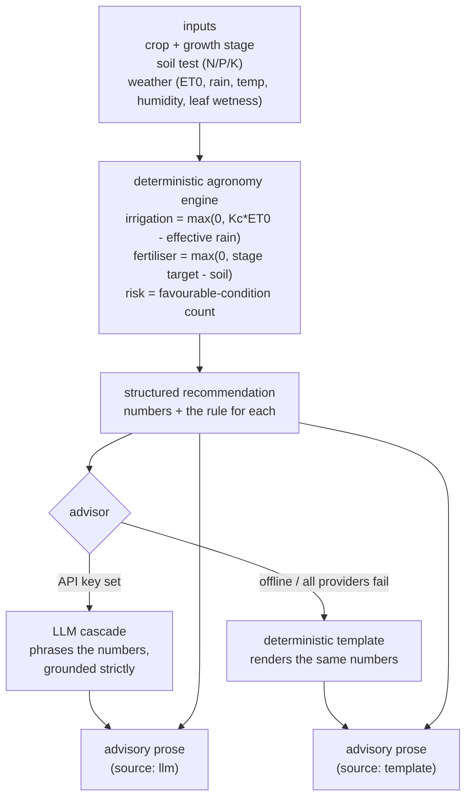

# AgroAdvisor

An agrotech advisory that turns a crop, its growth stage, a soil test and recent
weather into concrete agronomic recommendations — how much to irrigate, how much
N/P/K to top up, and the pest/disease risk right now. The recommendations and
every number in them are computed by a **deterministic agronomy engine**; a
language model only *phrases* the result, and when no model is reachable a
template renders the identical numbers. The system runs fully offline by default.

## Why it matters

Most "AI farm advisor" demos let a language model invent the numbers — how many
millimetres to irrigate, how many kilograms of nitrogen to apply. That is exactly
the wrong place for a model that can hallucinate. AgroAdvisor inverts it:

- the **substance** (the irrigation depth, the nutrient deficits, the risk level)
  is plain, auditable arithmetic in `engine.py`, with explicit units and the rule
  behind every figure; and
- the **language model** is confined to presentation — it rephrases the computed
  figures in readable prose, grounded strictly in them, and is told to invent,
  change or omit nothing.

Take the model away entirely and the advice does not change: the offline template
renders the same numbers. The model makes the output nicer to read; it never
decides what the output *is*.

## How it works



1. **Knowledge base (`crops.py`, `knowledge.py`).** A few documented reference
   crops (maize, tomato, wheat), each with a per-growth-stage crop coefficient
   `Kc`, N/P/K stage targets (kg/ha), and the weather band that favours its key
   disease. These values are **illustrative**, not calibrated for any real region.
2. **Engine (`engine.py`).** Pure arithmetic: crop water demand `ETc = Kc*ET0`,
   net irrigation `max(0, ETc - effective_rainfall)` (mm/day, equal to litres/m²);
   nutrient deficit `max(0, stage_target - soil_test)` per nutrient; and a
   pest/disease risk level from how many of three weather conditions hold. Same
   inputs, same numbers, every time — no network, no API key.
3. **Advisor (`advisor.py`).** Renders the structured recommendation into prose.
   The LLM path puts the computed numbers in the prompt and forbids inventing any;
   the offline template renders those same numbers. Each result records its
   `source` (`llm` or `template`).

## The honest split: deterministic substance, LLM phrasing

This project is deliberate about which part is trustworthy and which is cosmetic.

- **The numbers are not the model's.** Irrigation depth, nutrient deficits and the
  risk level come only from `engine.py`. The model is never asked "how much should
  I irrigate?" — it is handed "net irrigation = 2.95 mm/day" and asked to say it
  nicely.
- **The model cannot smuggle a value in.** The offline template is covered by a
  test (`test_template_invents_no_numbers`) that asserts every numeric token it
  prints is one the engine computed. The LLM is instructed to do the same; because
  its output is non-deterministic it is not the source of truth, which is why the
  structured recommendation is always returned alongside the prose.
- **The agronomy values are illustrative.** The `Kc` figures are rounded from
  published FAO-56 ranges; the NPK stage targets and disease weather bands are
  plausible teaching values, not a calibrated agronomic model. They exist to make
  the engine's arithmetic transparent, not to be applied to a real field.

## Quick start

```bash
python -m venv .venv && source .venv/bin/activate
pip install -e ".[dev]"

python -m agroadvisor.cli demo          # three scenarios: computed numbers + offline advisory
uvicorn agroadvisor.main:app --reload   # HTTP API
```

Example API calls:

```bash
# Available crops and stages
curl -s localhost:8000/crops

# A dry-spell maize field at the vegetative stage
curl -s -X POST localhost:8000/advise -H 'content-type: application/json' -d '{
  "crop": "maize", "stage": "vegetative",
  "soil":    {"n_kg_ha": 50, "p_kg_ha": 15, "k_kg_ha": 30},
  "weather": {"et0_mm": 6.5, "rainfall_mm": 2.0, "temperature_c": 30,
              "humidity_pct": 50, "leaf_wetness_hours": 2}
}'
```

The response carries the full structured `recommendation` (every number and the
rule that produced it), the `advisory` prose, and the `advisory_source`.

## Configuration

Settings load from environment variables with the `AA_` prefix (see
`.env.example`). All are optional; defaults run fully offline.

| Variable                         | Default                                   | Meaning                                                   |
| -------------------------------- | ----------------------------------------- | --------------------------------------------------------- |
| `AA_EFFECTIVE_RAINFALL_FRACTION` | `0.8`                                     | Fraction of rainfall that reaches the root zone           |
| `AA_RISK_MODERATE_AT`            | `2`                                       | Favourable-condition count (of 3) that makes risk MODERATE |
| `AA_RISK_HIGH_AT`                | `3`                                       | Favourable-condition count (of 3) that makes risk HIGH    |
| `AA_LLM_SPEC`                    | `anthropic,openai,gemini,deepseek,ollama` | Provider cascade, tried in order                          |
| `AA_LLM_MAX_TOKENS`              | `400`                                     | Token budget for the phrasing call                        |

Provider API keys (`ANTHROPIC_API_KEY`, `OPENAI_API_KEY`, …) are read from the
environment. With none set, the advisor uses the offline template.

## Testing

```bash
ruff check agroadvisor tests
pytest --cov=agroadvisor --cov-report=term-missing --cov-fail-under=80
```

The suite recomputes the engine's arithmetic by hand (irrigation net of rainfall,
fertiliser deficit, pest-risk thresholds including the inclusive boundaries),
checks the advisor's LLM path (with `FakeLLM`) and its template fallback (with
`FailingLLM`), asserts the template invents no numbers, and covers the HTTP API
and the CLI. No test touches the network: the LLM is always a test double.

## A note on scope

AgroAdvisor is a reference implementation and a portfolio piece, **not** a product
to make real crop decisions with. A real advisory needs locally calibrated crop
coefficients and nutrient budgets, a proper effective-rainfall and soil-water-
balance model, disease models validated against field data, and review by a
qualified agronomist. What this project demonstrates is the architecture: a
trustworthy deterministic core, with the language model kept firmly in a
presentational role where it cannot invent the numbers a grower would act on.

## Documentation

- `docs/architecture.md` — components, data flow, and the design rationale.
- `docs/adr/` — the main design decisions and their trade-offs.
- `docs/estudio/` — a study guide in Spanish, for learning the project in depth.

## License

MIT. See [LICENSE](LICENSE).
