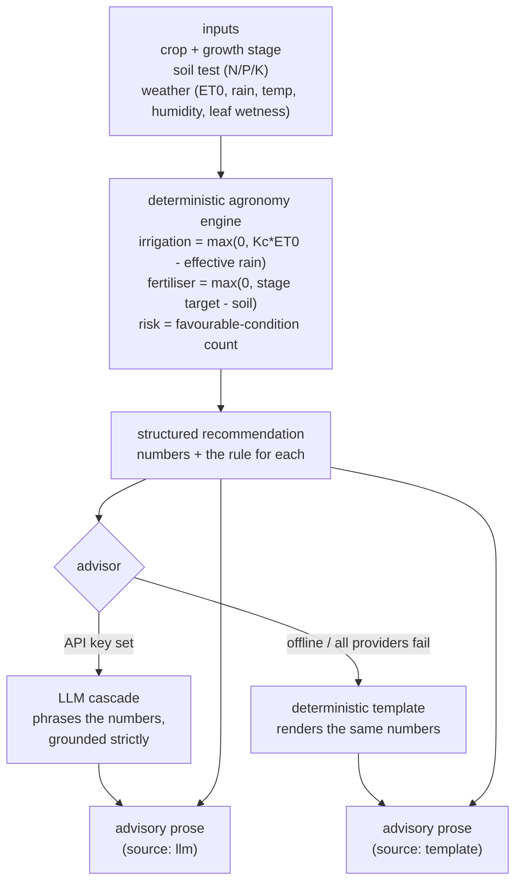

# Architecture

AgroAdvisor has a deterministic agronomy core and a thin, replaceable phrasing
layer. The core computes every recommendation; the phrasing layer (an LLM cascade
with an offline template fallback) only turns those computed numbers into prose
and is never trusted to produce a figure of its own.

## Components

| Component    | File                          | Responsibility                                                      |
| ------------ | ----------------------------- | ------------------------------------------------------------------- |
| Crop model   | `agroadvisor/crops.py`        | Types: growth stages, `Kc`, NPK targets, disease weather bands      |
| Knowledge    | `agroadvisor/knowledge.py`    | Illustrative reference values for a few crops; read-only lookup     |
| Engine       | `agroadvisor/engine.py`       | Deterministic irrigation, fertiliser and pest/disease arithmetic    |
| Advisor      | `agroadvisor/advisor.py`      | Phrase the computed recommendation (LLM, else template)             |
| LLM cascade  | `agroadvisor/llm/`            | Provider-agnostic client cascade with graceful fallback             |
| Service      | `agroadvisor/service.py`      | Orchestration: resolve crop → engine → advisor                      |
| HTTP API     | `agroadvisor/main.py`         | REST surface over the service                                       |
| CLI          | `agroadvisor/cli.py`          | End-to-end demo over three scenarios                                |

## Data flow

## Why the substance is deterministic, not generated

A grower acts on the numbers: a litre of water, a kilogram of fertiliser, a
spray decision. A language model that can hallucinate must not be the source of
those numbers. So the engine computes them with explicit arithmetic and units,
and returns, with each figure, the rule that produced it (for example
`net = max(0, Kc*ET0 - rainfall*0.8)`). The same inputs always produce the same
output — a property you can test by recomputing the arithmetic by hand, which the
test suite does.

## Why there is a language model at all

Structured numbers are not how a person wants to read advice. The LLM's job is
purely presentational: it receives the computed figures in its prompt and a
system instruction to rephrase them without inventing, changing or omitting any
value. Because the engine's structured recommendation is always returned next to
the prose, the prose is a convenience, not the contract — and the offline path
proves the point by producing the same substance with no model at all.

## Why the LLM is a cascade with an offline fallback

The advisor depends on an `LLMClient` interface, not a vendor. `build_llm` wires a
cascade of providers (Anthropic, OpenAI, Gemini, DeepSeek, a local Ollama model):
each is tried in order, and any failure — no API key, a rate limit, a network
error — falls through to the next. When every provider fails, which includes the
default no-key case, the advisor renders the deterministic template. This is why
the project is offline-first: nothing about producing correct advice depends on a
network call succeeding.

## Why the agronomy values are illustrative

The crop coefficients, nutrient targets and disease bands in `knowledge.py` are
rounded, plausible teaching values, not a calibrated agronomic model. They are
kept in one small, clearly-labelled module precisely so the engine's logic can be
read and trusted on its own, and so the data can be swapped for locally calibrated
values without touching the arithmetic.
